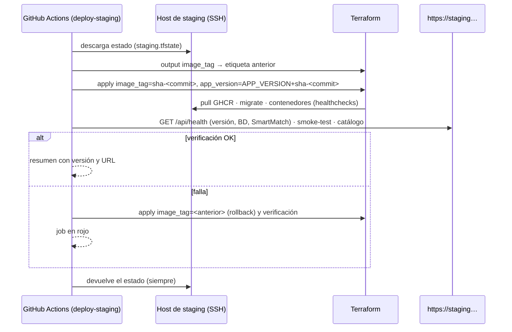

# 9. Infraestructura como código y ambiente de staging

> Código: [`infra/terraform`](../infra/terraform) · Decisión: [ADR-0010](adr/0010-terraform-proveedor-docker-staging.md) · Pipeline: [07-pipeline-devsecops.md](07-pipeline-devsecops.md)

## 9.1 Ambiente de staging

| Aspecto | Definición (EP1, completada en EP2) |
|---|---|
| Propósito | Validar cada versión integrada en `main` en condiciones similares a producción antes de una release (demo al docente, pruebas de aceptación, evaluación del motor) |
| Host | **Oracle Cloud Always Free**, región Chile Central (Santiago): VM `VM.Standard.A1.Flex` (Ampere, **ARM64**) con 2 OCPU y 12 GB, Ubuntu 24.04 y Docker Engine. Sin costo; las imágenes se publican para amd64 y arm64 ([ADR-0016](adr/0016-staging-oracle-cloud-arm.md)) |
| Acceso a Docker | Terraform se conecta por **SSH** (`docker_host = "ssh://deploy@<ip>"`) con un usuario `deploy` sin contraseña y llave dedicada; el daemon no se expone por TCP |
| Exposición | Solo el gateway web, ligado a `127.0.0.1:8080`; **Caddy** en el host publica `https://<ip-con-guiones>.sslip.io` en 443 con certificado automático de Let's Encrypt. Firewall: 22 (solo llaves), 80 (validación del certificado) y 443, abiertos en la lista de seguridad de Oracle y en iptables |
| Imágenes | Publicadas por el pipeline en GHCR con etiqueta inmutable `sha-<commit>` (y `main`); el staging nunca construye código |
| Datos | Volumen persistente `smartcommerce-staging-db-data`; catálogo poblado y refrescado cada 6 h por la **ingesta programada** (variable `ingestion` de Terraform); **sin datos personales reales** |
| Secretos | Distintos de dev y CI; en el ambiente `staging` de GitHub (`TF_VAR_*`), con aprobación requerida para aplicar |
| Salud | Tras cada despliegue: `GET /api/health` con la versión `APP_VERSION+sha-<commit>`, base de datos y SmartMatch arriba + `scripts/smoke-test.sh` contra la URL pública + lectura del catálogo |
| Despliegue | Automático desde GitHub Actions en cada push a `main` que pasa el quality gate (job `deploy-staging`, [ADR-0015](adr/0015-despliegue-staging-rollback.md)) |
| Rollback | Automático si falla la verificación; manual con el workflow *Rollback staging* (§9.7) |
| Estado de Terraform | Nunca en el repositorio. El `plan` del CI usa un estado local efímero; el despliegue guarda el estado en el host de staging (`~deploy/smartcommerce/terraform/staging.tfstate`, permisos 600) y lo descarga/devuelve por SSH en cada ejecución (`terraform init -backend-config=path=…`); `concurrency` impide despliegues simultáneos. Mejora futura: backend remoto con bloqueo |

En EP1 el staging **definitivo no se exige**: el pipeline ya levanta un **staging efímero** en cada ejecución (Docker Compose en el runner, con las imágenes escaneadas) y ejecuta pruebas de humo, aislamiento y resiliencia. Terraform describe el staging persistente y su `plan` se verifica en cada ejecución.

## 9.2 Estructura

```
infra/
├── docker/postgres/init/01-roles.sh        # roles de mínimo privilegio (compartido por Compose y Terraform)
└── terraform/
    ├── modules/smartcommerce-stack/        # módulo reutilizable: redes, volumen, imágenes y contenedores
    │   ├── versions.tf                     # Terraform ≥ 1.9, proveedor kreuzwerker/docker ~> 4.6
    │   ├── variables.tf                    # variables tipadas con validaciones (secretos marcados sensitive)
    │   ├── main.tf                         # recursos
    │   └── outputs.tf                      # URL, redes, volumen, contenedores e imágenes
    └── environments/
        ├── staging/                        # VM de staging (imágenes GHCR)
        │   ├── versions.tf · main.tf · variables.tf · outputs.tf
        │   ├── terraform.tfvars            # configuración NO sensible (versionada)
        │   ├── secrets.auto.tfvars.example # ejemplo local; los reales se ignoran por git
        │   └── .terraform.lock.hcl         # versiones y hashes exactos del proveedor
        └── dev/                            # Docker local con imágenes construidas localmente
```

**Separación de configuración:** el módulo no conoce ambientes; cada raíz define su proveedor (host Docker), su backend de estado, sus valores no sensibles (`terraform.tfvars`) y recibe los secretos por `TF_VAR_*`.

## 9.3 Recursos

| Recurso | Nombre (staging) | Detalle |
|---|---|---|
| `docker_network.edge` | `smartcommerce-staging-edge` | Pública: solo el gateway |
| `docker_network.api` | `smartcommerce-staging-api` | **Interna**: frontend → backend |
| `docker_network.services` | `smartcommerce-staging-services` | **Interna**: backend → python-service |
| `docker_network.data` | `smartcommerce-staging-data` | **Interna**: backend y migrate → database |
| `docker_network.egress` | `smartcommerce-staging-egress` | Salida a Internet solo para python-service |
| `docker_volume.db_data` | `smartcommerce-staging-db-data` | Datos de PostgreSQL |
| `docker_image.postgres` / `docker_image.app[*]` | `postgres:17.11-alpine3.24`, `ghcr.io/…/smartcommerce-*:<tag>` | Versiones fijas; se rechaza `latest` |
| `docker_container.database` | `…-database` | Healthcheck, script de roles subido al contenedor, `wait` hasta estar sano |
| `docker_container.migrate` | `…-migrate` | One-shot con rol owner; Terraform espera su término |
| `docker_container.python_service` | `…-python-service` | `read_only`, `cap_drop ALL`, `no-new-privileges`, límites |
| `docker_container.backend` | `…-backend` | Idem; depende de migrate y python-service |
| `docker_container.frontend` | `…-frontend` | Único puerto publicado; tmpfs para la configuración de Nginx |

### Variables principales

| Variable | Tipo | Sensible | Validación |
|---|---|---|---|
| `environment` | string | no | `dev` o `staging` |
| `runtime_env` | string | no | `staging` o `production` |
| `image_registry`, `image_tag` | string | no | `image_tag` ≠ `latest` |
| `frontend_bind_ip`, `frontend_port` | string, number | no | IPv4 válida; puerto 1024–65535 |
| `cors_origins` | list(string) | no | — |
| `resources` | map(object) | no | Debe definir los 4 servicios |
| `postgres_superuser_password`, `db_owner_password`, `db_app_password` | string | **sí** | ≥ 16 caracteres |
| `jwt_access_secret`, `internal_api_token` | string | **sí** | ≥ 32 caracteres |

### Salidas

`frontend_url`, `health_url`, `networks` (nombre → interna), `database_volume`, `containers` e `images`. Ninguna salida expone secretos.

## 9.4 Uso

```bash
cd infra/terraform/environments/staging

# Secretos (en CI provienen de GitHub Secrets del ambiente staging)
export TF_VAR_postgres_superuser_password="$(openssl rand -base64 32)"
export TF_VAR_db_owner_password="$(openssl rand -base64 32)"
export TF_VAR_db_app_password="$(openssl rand -base64 32)"
export TF_VAR_jwt_access_secret="$(openssl rand -base64 48)"
export TF_VAR_internal_api_token="$(openssl rand -base64 48)"

terraform init
terraform fmt -check -recursive ../..
terraform validate
terraform plan -var "docker_host=ssh://deploy@<ip-staging>" -var "image_tag=sha-<commit>" -out staging.tfplan
terraform apply staging.tfplan          # solo con aprobación (fuera del alcance de EP1)
BASE_URL=https://staging.<dominio> ../../../../scripts/smoke-test.sh
```

Para **dev** (Docker local): `docker compose build` genera las imágenes `smartcommerce-*:local` y `terraform -chdir=infra/terraform/environments/dev apply` levanta el stack en `http://127.0.0.1:8081`.

## 9.5 En el pipeline

El job **Terraform** (bloqueante, parte del quality gate) ejecuta en cada PR y push a `main`:

1. `terraform fmt -check -recursive`.
2. `terraform init -backend=false` + `terraform validate` para `dev` y `staging`.
3. `terraform plan` de **staging** contra el daemon Docker del runner, con las etiquetas `sha-<commit>` y secretos del ambiente `staging` (o efímeros si no existen). El plan legible se publica como artefacto (`plan-staging.txt`, valores sensibles ocultos); el archivo binario del plan nunca se sube porque contiene secretos.

## 9.6 Despliegue automático (EP2)



El job solo corre si existe la variable `STAGING_DOCKER_HOST`; sin host configurado el pipeline sigue validando cada versión en el staging efímero.

## 9.7 Puesta en marcha del host y rollback

**Una sola vez.** La guía paso a paso para crear la VM en Oracle Cloud (cuenta, instancia y apertura de puertos), pensada para cualquier integrante del equipo, está en la sección 9.7.1. Con la VM creada y su IP pública:

```bash
# 1. Preparar el host (Docker, usuario deploy, SSH solo con llaves, firewall y Caddy con HTTPS).
#    Es idempotente: se puede repetir sin romper nada.
IP=<ip-publica>
DOMINIO="${IP//./-}.sslip.io"
ssh -i ~/.ssh/smartcommerce_staging_admin ubuntu@"$IP" \
  "sudo bash -s -- $DOMINIO '$(cat ~/.ssh/smartcommerce_staging_deploy.pub)'" \
  < infra/staging/bootstrap-oracle.sh

# 2. Huella del host para el pipeline (evita ataques de intermediario)
ssh-keyscan -t ed25519 "$IP"
```

Las llaves se generan en el equipo del administrador con `ssh-keygen -t ed25519 -f ~/.ssh/smartcommerce_staging_<admin|deploy>`: la de administración se pega al crear la VM y la de despliegue la instala el script para el usuario `deploy`.

**En GitHub (ambiente `staging`):**

| Dónde | Nombre | Valor |
|---|---|---|
| Variable | `STAGING_DOCKER_HOST` | `ssh://deploy@<ip-publica>` (activa el job `deploy-staging`) |
| Variable | `STAGING_URL` | `https://<ip-con-guiones>.sslip.io` |
| Variable | `STAGING_SSH_KNOWN_HOSTS` | Salida de `ssh-keyscan -t ed25519 <ip>` (es pública: no necesita ser secreto) |
| Secreto | `STAGING_SSH_PRIVATE_KEY` | Contenido de `~/.ssh/smartcommerce_staging_deploy` (llave **privada**) |
| Secretos | Los cinco de la aplicación | Ya configurados ([08 · §8.3](08-variables-y-secretos.md#83-github-actions)) |

Las imágenes de GHCR deben ser **públicas** (*perfil › Packages › paquete › Package settings › Change visibility › Public*) para que el host las descargue sin credenciales. El repositorio es público y las imágenes no contienen secretos.

### 9.7.1 Crear la VM en Oracle Cloud

1. Crear la cuenta en [signup.cloud.oracle.com](https://signup.cloud.oracle.com/) con la región de inicio **Chile Central (Santiago)** (no se puede cambiar después). La verificación con tarjeta no cobra: los recursos *Always Free* no tienen costo.
2. *Compute › Instances › Create instance*: imagen **Canonical Ubuntu 24.04**, forma **VM.Standard.A1.Flex** (pestaña *Ampere*) con 2 OCPU y 12 GB, red y subred pública nuevas con IPv4 pública, y en *Add SSH keys* pegar `~/.ssh/smartcommerce_staging_admin.pub`. Si aparece *Out of capacity*, probar otro *availability domain*, bajar a 1 OCPU y 6 GB, o reintentar más tarde.
3. En la subred (*Primary VNIC › Subnet › Security Lists › Default Security List › Add Ingress Rules*) agregar dos reglas TCP desde `0.0.0.0/0`, a los puertos 80 y 443.
4. Copiar la **IP pública** de la instancia y continuar con el script de preparación.

**Rollback:**

| Situación | Acción |
|---|---|
| Falla el despliegue, el servicio no inicia o fallan los endpoints de salud | Automático: el job vuelve a la etiqueta anterior y lo informa en el resumen |
| Error crítico o vulnerabilidad grave detectada después | *Actions › Rollback staging › Run workflow* con `sha-<commit>` de la última versión estable (las etiquetas de GHCR son inmutables) |
| Versión incompatible con la base de datos | Las migraciones son aditivas (expandir → contraer): la versión anterior funciona sobre el esquema nuevo. Un cambio destructivo se reparte en dos versiones |
| Pérdida del host | Nueva VM + mismo procedimiento; `terraform apply` sobre estado vacío recrea todo; la base se restaura desde un respaldo (`pg_dump` programado, trabajo futuro) |

Para identificar qué está desplegado: `curl https://staging.<dominio>/api/health` → `"version": "0.2.0+sha-<commit>"`, o el resumen del último job `deploy-staging`.

## 9.8 Próximos pasos

- Módulo para aprovisionar la VM en un proveedor cloud y DNS; backend remoto de estado con bloqueo.
- Respaldo programado del volumen de PostgreSQL y rotación de secretos.
