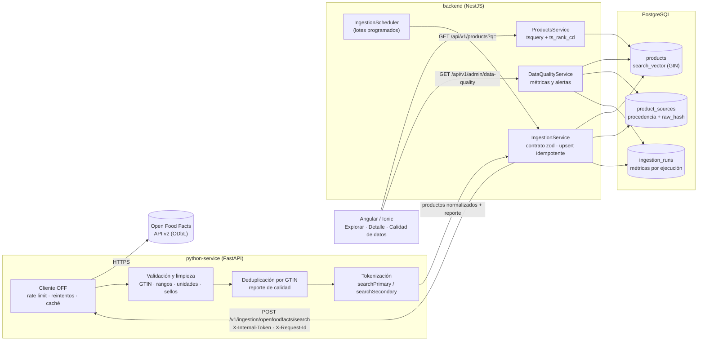

# 10. Recuperación, preparación, indexación y evaluación de la información web (EP2)

> Pregunta orientadora de la EP2: *¿cómo obtiene, prepara, valida e integra el sistema información proveniente de la Web para utilizarla después en una capacidad adaptativa?*
> Fuente y aspectos legales: [04 · Fuente web](04-fuente-web.md) · Decisiones: [ADR-0013](adr/0013-ingesta-programada-sin-cola.md), [ADR-0014](adr/0014-indice-busqueda-postgresql.md), [ADR-0015](adr/0015-despliegue-staging-rollback.md)

## 10.1 Flujo completo



## 10.2 Extracción automatizada

| Aspecto | Implementación |
|---|---|
| Disparo manual | `POST /api/v1/admin/ingestions` (admin/operator): una página de un país y categoría |
| Disparo programado | `IngestionScheduler` (NestJS) cada `INGESTION_INTERVAL_MINUTES` (staging: 6 h) sobre `INGESTION_TARGETS` (`chile/breakfast-cereals,chile/dairies,…`), hasta `INGESTION_MAX_PAGES` páginas por objetivo; se detiene cuando una página viene incompleta |
| Ejecución inmediata del lote | `POST /api/v1/admin/ingestions/schedule/run` → **202** (asíncrono); `GET …/schedule` muestra estado, próxima ejecución y resultado por objetivo |
| Concurrencia | Un lote a la vez: bandera local + `pg_try_advisory_lock` (seguro con varias réplicas) |
| Respeto por la fuente | User-Agent identificable, ≤ 8 búsquedas/min (límite oficial 10), solo los campos necesarios (`fields=`), caché TTL de 5 min |
| Errores de la fuente | Timeout 10 s, reintentos acotados con backoff y jitter solo ante 429/5xx/timeout/red; luego `UPSTREAM_UNAVAILABLE` |
| Indisponibilidad | La ejecución queda `failed` con el motivo, el lote sigue con el siguiente objetivo (`partial`) y **los datos ya almacenados no se tocan**; la API responde 502 `SOURCE_UNAVAILABLE` sin detalles internos |
| Trazabilidad | Cada página es una fila de `ingestion_runs` (`params.trigger = manual | scheduled`, `request_id`); el `X-Request-Id` viaja NestJS → Python y aparece en los logs de ambos |

## 10.3 Validación, limpieza y normalización

El detalle de reglas está en [04 · §4.5](04-fuente-web.md#45-limpieza-y-normalización). Resumen del orden en `app/normalization/normalizer.py`:

1. **Esquema y obligatorios**: registro con formato de objeto, GTIN válido (dígito de control GS1) y nombre; si no, se **rechaza** con motivo (`rejections`).
2. **Limpieza de texto**: sin caracteres de control, espacios colapsados, longitudes acotadas.
3. **Normalización**: etiquetas sin prefijo de idioma, alérgenos a vocabulario controlado, cantidades a g/ml, sodio desde sal, grados `a–e`, NOVA 1–4, nutrientes fuera de rango → nulo con advertencia.
4. **Derivados**: sellos "ALTO EN" (Ley 20.606), aptitud de dietas, puntaje de calidad del dato (0–1).
5. **Índice de búsqueda** (nuevo en EP2, `app/normalization/text.py`):
   - plegado a minúsculas sin tildes (`Instantánea` → `instantanea`), separación por símbolos;
   - palabras vacías del español y tokens de una letra fuera;
   - plurales regulares (`cereales` → `cereal`, `semillas` → `semilla`) y prefijo `multi-` (`multisemillas` aporta `semilla`);
   - **vocabulario controlado** de categorías y sellos en inglés → español (`breakfast-cereals` → `cereal desayuno`, `no-added-sugar` → `sin azucar anadida`);
   - `searchPrimary` = nombre + marcas (peso A) y `searchSecondary` = nombre genérico + categorías + sellos (peso B).
6. **Deduplicación** dentro del lote por GTIN canónico (se conserva el más completo y reciente) y **reporte de calidad** (`received`, `valid`, `rejected`, `duplicates`, `validRatio`, `duplicateRatio`, `fieldCoverage`, `tookMs`).

La consulta del usuario se normaliza en NestJS con **las mismas reglas** (`backend/src/common/text-normalization.ts`); los dos lados ejecutan los mismos casos de prueba (`python-service/tests/fixtures/text_normalization_cases.json`).

## 10.4 Persistencia, procedencia e indexación

| Elemento | Dónde | Detalle |
|---|---|---|
| Datos externos normalizados | `products` | Una fila por GTIN (`UNIQUE`), nutrientes, sellos, alérgenos, dietas, puntaje de calidad, `search_primary`, `search_secondary` |
| Índice de búsqueda | `products.search_vector` | Columna **generada** `setweight(to_tsvector('simple', search_primary),'A') \|\| setweight(…secondary,'B')` con índice **GIN** `products_search_vector_gin` |
| Procedencia | `product_sources` | Fuente, `external_id`, URL pública del registro, **SHA-256 del dato crudo**, última modificación en la fuente, **fecha y hora de recuperación**, ejecución que lo produjo; `UNIQUE (source_id, external_id)` |
| Ejecuciones | `ingestion_runs` | Parámetros, disparador, conteos (obtenidos, válidos, nuevos, actualizados, sin cambios, duplicados, rechazados), reporte de calidad, error, `request_id`, tiempos |
| Evitar duplicados | — | En el lote (GTIN) y entre ingestas (`UNIQUE` + upsert). Si el `raw_hash` no cambió el producto **no se reescribe** (`unchanged`) |
| Criterios de búsqueda e índices | — | GIN de texto, `category_id`, `nutriscore_grade`, `data_quality_score DESC`, GIN de alérgenos, `product_sources(fetched_at)` para actualidad |
| Relación con datos propios | — | `favorites`, `user_interactions` y `recommendation_logs` referencian `products.id`: el comportamiento del usuario se vincula a los productos recuperados (base del módulo adaptativo) |

Migración: [`1760500000000-SearchIndex.ts`](../backend/src/database/migrations/1760500000000-SearchIndex.ts) (reversible; probada con *down + up* en las pruebas e2e). Modelo completo: [03 · Modelo de datos](03-modelo-datos.md).

## 10.5 Recuperación de información (buscador)

| Componente | Implementación |
|---|---|
| Corpus | Catálogo de productos recuperados de Open Food Facts (Chile) |
| Mecanismo de consulta | `GET /api/v1/products?q=…` (público) con filtros combinables: categoría, Nutri-Score, NOVA máximo, alérgenos excluidos |
| Tokenización | Mismas reglas que el índice; máximo 8 términos; caracteres de control y texto mal codificado → 400 |
| Consulta | `tsquery` de prefijos unidos con OR (`avena:* \| instantanea:*`) construida solo con `[a-z0-9]`: el usuario no puede inyectar operadores. `ILIKE` como respaldo para subcadenas |
| Ranking | `ts_rank_cd(search_vector, q, 1)`: más términos encontrados y más cercanos puntúan más, el nombre/marca pesa más que categorías y sellos, y se normaliza por largo del documento; empates por calidad del dato |
| Resultados | Cada ítem incluye `relevance`; el detalle muestra la procedencia (fuente, licencia, URL, fecha de recuperación) |
| Interfaz | *Explorar* indica "ordenados por relevancia" cuando hay texto y permite buscar por sellos ("sin azúcar") |

## 10.6 Evaluación de la información recuperada

Se aplican **dos estrategias complementarias**: calidad de los datos recuperados (cada ingesta y en producción) y calidad del ranking del buscador (conjunto juzgado, en CI).

### 10.6.1 Métricas de calidad de los datos

`GET /api/v1/admin/data-quality?days=N` (admin/operator) y la pantalla *Administración › Calidad de datos*.

| Métrica | Definición | Por qué es pertinente | Umbral de alerta |
|---|---|---|---|
| % de registros válidos | válidos / obtenidos en la ventana | La fuente es colaborativa: mide cuánto descarta la validación | < 80 % (`LOW_VALID_RATIO`) |
| % de duplicados | duplicados en lote / obtenidos | Detecta problemas de paginación o de la fuente | > 10 % (`HIGH_DUPLICATE_RATIO`) |
| Cobertura de campos | % de productos con marca, categoría, cantidad, Nutri-Score, NOVA, Eco-Score, nutrientes completos, imagen, tiendas, precio | El motor renormaliza criterios faltantes: la cobertura acota la calidad de la recomendación | Informativa |
| Cobertura de la fuente | almacenados / disponibles en la fuente por categoría | Qué parte del universo real conoce el sistema | Informativa |
| Actualidad | edad mediana desde la última recuperación; % desactualizado (> `DATA_STALE_AFTER_DAYS`, 14 días); edad mediana desde la última edición en la fuente | Valida la estrategia de actualización | > 20 % desactualizado (`STALE_DATA`) |
| Tasa de errores | ingestas fallidas / ingestas; errores de la fuente medidos por Python por tipo (timeout, red, http_5xx) | Disponibilidad real de la fuente | > 20 % (`HIGH_ERROR_RATE`) |
| Tiempo de recuperación | duración promedio y p95 por ejecución; latencia promedio y p95 de Open Food Facts | Dimensiona lotes y timeouts | Informativa |
| % indexado | productos con `search_primary` no vacío | Todo lo recuperado debe ser buscable | Informativa |

**Resultado real (prueba local de extremo a extremo, 15-10-2026, ingesta programada contra la API real de Open Food Facts):**

| Métrica | Valor |
|---|---|
| Registros obtenidos / válidos / rechazados / duplicados | 40 / 38 / 2 (sin nombre) / 0 |
| % válidos · % duplicados | **95 %** · **0 %** |
| Cobertura de la fuente (cereales de desayuno) | 38 de 122 disponibles = **31,1 %** (una página de 40) |
| Cobertura de campos | marca 94,7 % · categoría 100 % · cantidad 71,1 % · Nutri-Score 73,7 % · NOVA 57,9 % · Eco-Score 97,4 % · nutrientes completos 73,7 % · imagen 97,4 % · tiendas 13,2 % · **precio 0 %** |
| Actualidad | 0 % desactualizado; mediana de 120 días desde la última edición en la fuente |
| Errores | La categoría *dairies* respondió **HTTP 503** tres veces (con reintentos): lote `partial`, alerta `HIGH_ERROR_RATE` (50 % de ejecuciones) y tasa de error de la fuente 75 % en esa ventana; los cereales quedaron disponibles |
| Tiempo | 2,2 s la ingesta exitosa; p95 de 20,5 s por los reintentos de la fallida |

Interpretación: la validación descarta poco (95 % válido) y la deduplicación no encontró repetidos en la fuente; los vacíos importantes son **precio (0 %)**, tiendas (13 %) y NOVA (58 %), que el motor trata como criterios faltantes con renormalización y menor confianza. El escenario de error real demostró que una caída parcial de la fuente no afecta al resto del catálogo.

### 10.6.2 Evaluación del buscador (Precision@K, MRR, nDCG)

- **Corpus**: [`evaluation/retrieval/corpus.json`](../evaluation/retrieval/corpus.json), 23 cereales reales de Open Food Facts Chile, generado con `python-service/scripts/build_search_corpus.py` desde la instantánea de pruebas (mismo pipeline de normalización).
- **Consultas juzgadas**: [`evaluation/retrieval/queries.json`](../evaluation/retrieval/queries.json), 10 consultas con relevancia binaria definida por el equipo **antes de medir** (intención explícita por consulta).
- **Procedimiento**: [`backend/test/retrieval.e2e-spec.ts`](../backend/test/retrieval.e2e-spec.ts) ingiere el corpus por la API real con PostgreSQL real y consulta `GET /api/v1/products` con dos órdenes sobre el **mismo** conjunto de coincidencias. Corre en cada pipeline; el reporte queda en el artefacto `coverage-backend` y en el resumen del job.
- **Métricas**: P@5 (lo que ve el usuario en la primera pantalla), R@5, Recall total, MRR (posición del primer resultado útil) y nDCG@5 (premia los relevantes arriba). Con juicios binarios y consultas de 2–6 relevantes, **el P@5 máximo alcanzable es 0,78**.

| Estrategia | P@5 | R@5 | Recall | MRR | nDCG@5 |
|---|---|---|---|---|---|
| Base EP1: orden por calidad del dato | 0,62 | 0,81 | 0,947 | 0,933 | 0,840 |
| **EP2: relevancia `ts_rank_cd` (normalización 1)** | **0,70** | **0,888** | 0,947 | **1,000** | **0,927** |

Elección de la variante (mismo índice y consultas; se eligió antes de fijar umbrales):

| `ts_rank_cd` normalización | P@5 | MRR | nDCG@5 |
|---|---|---|---|
| 0 (sin normalizar por largo) | 0,68 | 0,95 | 0,891 |
| **1 (÷ 1 + log largo)** | **0,70** | **1,00** | **0,927** |
| 2 (÷ largo) | 0,70 | 1,00 | 0,930 |

Se eligió **1**: igual P@5 y MRR que 2 y penaliza menos los productos con descripciones largas (diferencia de nDCG de 0,003, no significativa con 10 consultas).

Resultados por consulta (relevancia): `avena` P@5 0,8 (MRR 1; con el orden base era 0,33: la granola con avena aparecía primero) · `granola`, `semillas`, `nestlé`, `fibra`, `almendras` nDCG 1 · `sin azúcar` P@5 1,0 gracias al vocabulario de sellos · `cereal chocolate` 0,6 (`cereal` aparece en todo el corpus) · `quaker` recall 0,8 (un registro dice "Quajer" en la fuente) · `proteína` recall 0,67 (un producto dice "PROTEIN").

El test **falla el pipeline** si el recall baja de 0,8, el MRR de 0,8, o si la relevancia deja de superar a la línea base en P@5 y nDCG@5.

**Limitaciones de la evaluación**: corpus pequeño y de una sola categoría; juicios de un solo equipo (sin acuerdo entre evaluadores); sin corrección ortográfica ni sinónimos entre idiomas. En la entrega final se ampliará a varias categorías y se medirá Precision@5 de las **recomendaciones** personalizadas contra la versión base ([05 · §5.8](05-motor-smartmatch.md#58-plan-de-evaluación)).

## 10.7 Cómo reproducir

```bash
# Python: normalización, tokenización y fuente (cobertura ≥ 85 %)
cd python-service && uv run pytest
uv run python scripts/build_search_corpus.py          # regenera evaluation/retrieval/corpus.json

# Backend: integración con PostgreSQL real + evaluación del buscador
cd backend && DB_HOST=localhost DB_PASSWORD=<clave> npm run test:e2e
cat reports/retrieval-evaluation.json

# Stack completo con la fuente simulada (determinista) y pruebas de integración EP2
COMPOSE_FILE=docker-compose.yml:docker-compose.source-mock.yml docker compose up -d --build
#   (en .env: OFF_BASE_URL=http://off-mock:8080)
COMPOSE_FILE=docker-compose.yml:docker-compose.source-mock.yml scripts/integration-test.sh
```
